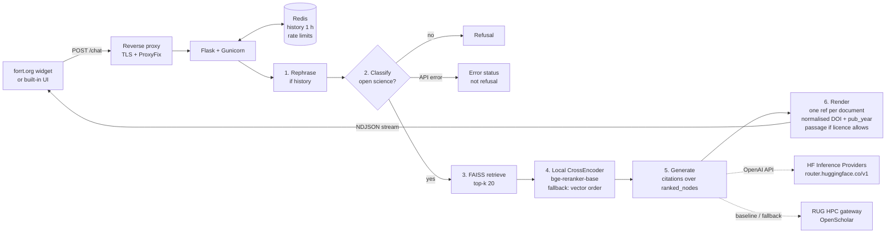
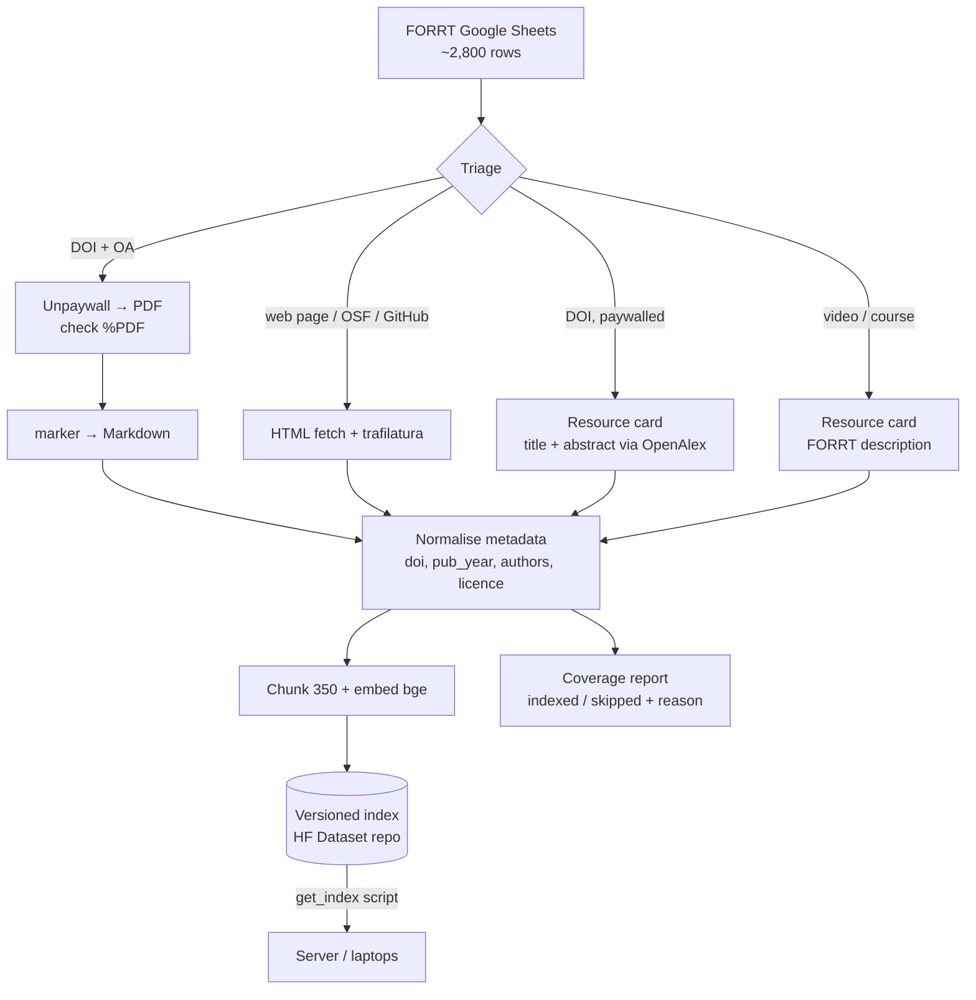

# JUST-OS Open Science Chatbot — Project Plan

**Role:** Research Assistant, FORRT  **Version:** v0.2, 23 October 2026  **Repo:** [forrtproject/JUST-OS](https://github.com/forrtproject/JUST-OS) (commit `20bb9e0`)
**Status:** Draft.

This plan has two parts:

- **Part A: Overview.** Short. Read this first. Written in ASD-STE100 Simplified Technical English.
- **Part B: Detailed plan.** Code audit (keep / change / discard), architecture, requirements, rules, and a day-by-day task list for before, during and after the hackathon (11–13 November 2026).

---

# PART A — OVERVIEW (ASD-STE100)

## A1. Purpose

JUST-OS is a chatbot for open-science questions. It gives answers with citations to the FORRT resource library. It operates as a widget on forrt.org. This project makes the answers more accurate. It also makes the hosting safe and not expensive.

## A2. Current condition

The chatbot operates now. A Flask server finds text in 588 open-access documents. The server sends the text to the Llama-3.1-OpenScholar 8B model. The RUG HPC gateway operates this model. Only dedicated GPUs can operate this model. This is a risk for the service.

## A3. Main problems in the code

1. **Incorrect sources.** The answer uses one list of sources. The reference links use a different list. Thus, a citation number can show the incorrect paper.
2. **Incorrect year.** The code shows the date of the form entry, for example "01/01/2020". It does not show the publication year.
3. **Incorrect DOI links and duplicate papers.** The code shows the link from the spreadsheet without changes. It shows one reference for each text chunk, not one for each paper.
4. **Empty answers.** When the re-ranker fails, the code deletes all sources.
5. **Hidden errors.** When the model API fails, the bot tells the user that the question is not about open science.
6. **Low coverage.** Only open-access PDFs with a DOI go into the index. Web pages, courses, videos and paywalled papers do not go in.
7. **Difficult setup.** The vector index is not in the repository. There are no tests.

## A4. Decisions

1. Keep OpenScholar on the RUG gateway until the model comparison is complete. The improvements do not depend on the model.
2. After the comparison, operate the best model on a free university GPU server if one is available. If no server is available, use **Hugging Face Inference Providers**. Do not rent a GPU for the current traffic. A change of model is a change of one setting.
3. Do not train a new model.
4. Run the re-ranker on the server CPU. Do not use a remote re-ranker.
5. Keep the API of the `/chat` endpoint the same. The forrt.org widget uses this API.
6. Measure each change with an evaluation set before you keep it.

## A5. Timeline

| Phase | Dates | Who | Result |
|---|---|---|---|
| 1. Prepare | 23 Oct – 10 Nov | You | The code runs with Hugging Face. The critical bugs are repaired. There is a first evaluation tool. The team can start in 30 minutes. |
| 2. Hackathon | 11 – 13 Nov (3 × 9 h) | Team of 4 | Evaluation set of 40–60 questions. Correct references. Comparison of 4–6 models. Coverage report. Local demo. |
| 3. Continue | 16 Nov – mid Jan | You | Better retrieval. More resources in the index. Staging server. New model in production. Documentation. |

## A6. Demo on 13 November

Show these items on a local computer:
1. A table that compares the scores before and after the hackathon.
2. A live answer with correct citation numbers, years, DOI links and source passages.
3. A table that compares 4–6 models for quality, speed and cost.
4. A chart that shows why resources are not in the index.
5. A change of model with one setting.

## A7. Hardware and cost

The web server does not need a GPU. Use 4 vCPU, 16 GB RAM and 100 GB SSD in the EU. The model API cost for the hackathon is less than 20 EUR. The production cost is less than 25 EUR each month for 10,000 questions. Verify these values before you start.

## A8. Risks

1. The team cannot get the vector index. Get the index before 1 November.
2. The team is smaller than 4 people. Then do the coverage work after the hackathon.
3. The provider stops a model. Keep a second model and the RUG gateway as backups.
4. Make sure that no API key goes into Git.

---

# PART B — DETAILED PLAN

## B1. Goals and success measures

| Goal | Measure (confirm targets after the baseline) |
|---|---|
| Accurate, well-sourced answers | Retrieval hit@5 ≥ 0.85; citation support ≥ 0.90 (LLM judge) |
| Correct references | Citation number → correct document 100 %; DOIs resolve 100 %; 0 duplicate papers; year = publication year |
| Correct refusals | ≥ 0.95 refusal on off-topic; ≤ 0.05 false refusal on in-scope; API errors shown as errors, not refusals |
| Sustainable hosting | Model served by ≥ 2 Hugging Face providers **and** self-hostable on 1 GPU; monthly cost under an agreed cap |
| Coverage | Report of every non-indexed FORRT row by reason; one new ingestion route for the largest group |
| Easy contribution | Fresh clone → running bot in ≤ 30 min; `pytest` runs without the 700 MB index |

Out of scope unless FORRT asks: new UI design, user accounts, multilingual answers, fine-tuning.

---

## B2. Code audit: keep, change, discard

Audit of commit `20bb9e0` (23 Oct 2026). Severity: **C** = critical (wrong output to users), **H** = high, **M** = medium, **L** = low.

### B2.1 Keep (works, fits our requirements)

| Component | Where | Why keep |
|---|---|---|
| `/chat` streaming API contract (`message`, `chat_id`, NDJSON `status`/`message`/`metadata`) | [just_os/app.py](../just_os/app.py) | The forrt.org widget depends on it. Do not change it |
| Pipeline shape: rephrase → classify → retrieve → rerank → generate → render | [just_os/qualle.py](../just_os/qualle.py) `Qualle.get_response` | Sound RAG design. We fix the steps, not the structure |
| `OpenAIClientManager` (OpenAI client with `base_url`) | `qualle.py:420` | This is what makes Hugging Face a config change |
| Redis chat history (1 h TTL) | [just_os/chat_manager.py](../just_os/chat_manager.py) | Simple, privacy-friendly |
| Rate limiting, CORS allow-list, message length validation | `app.py:20–152` | Needed for a public endpoint |
| Config via `DEFAULT_CONFIG` + env override | [config/settings.py.example](../config/settings.py.example) | Lets us switch models by env var. Just add new keys |
| LlamaIndex + FAISS + `HuggingFaceEmbedding` (bge-small, CPU) | [just_os/rag_service.py](../just_os/rag_service.py), [embed.py](../embed.py) | Light, works, no GPU |
| Reference renumbering by order of appearance | `qualle.py:499–600` | Good logic; only the node list it uses is wrong |
| Reference tooltip in the built-in UI (shows title, authors, year, chunk text, link) | [assets/js/app.js](../assets/js/app.js) | Passages already exist here; reuse for the widget |
| OpenScholar prompt | [just_os/openscholar.py](../just_os/openscholar.py) | Keep for the OpenScholar baseline (Apache-2.0 attribution intact) |
| Ingestion helpers: Unpaywall lookup, concurrent runner, marker PDF→Markdown | [ingest/helpers.py](../ingest/helpers.py), [marker.sh](../marker.sh) | Reusable for new ingestion routes |
| Docker Compose, multi-stage Dockerfile, `uv`, `run` task script | repo root | Good base for dev and prod |
| Seed data for eval: 1,282 generated (question, text) pairs | `data/interim/questions_and_text.csv` | Seeds the eval set (needs mapping text → document) |

### B2.2 Change (keep the idea, fix the code)

| # | Sev | Finding | Where | Fix |
|---|---|---|---|---|
| 1 | **C** | The LLM sees `ranked_nodes` numbered `[0..6]`, but citations and the source list are rendered against `all_nodes` (pre-rerank order). Citation `[2]` can link to a **different paper** than the one the model used | `qualle.py:791`, `qualle.py:809` | Pass `ranked_nodes` to `process_with_references` and `references_from_nodes`. Add a regression test |
| 2 | **C** | Rerank failure returns `[]` → "couldn't find any relevant information" | `qualle.py:263–264` | Fall back to the top `MAX_CHUNKS` by vector score |
| 3 | **H** | "Year" is the Google-Form `timestamp` (e.g. `01/01/2020`), not publication year | `qualle.py:566–567`, `621`, `629` | Add `pub_year` at ingestion (OpenAlex/Crossref by DOI); fall back to "n.d." |
| 4 | **H** | Link is raw `link_to_resource`; DOI regex `10\.\d{4,}/[\w/.-]+` keeps trailing dots and cuts DOIs with `()`, `;`, `:` | `qualle.py:569`, [ingest/helpers.py:28](../ingest/helpers.py) | One `normalize_doi()`; render `https://doi.org/<doi>`; unit tests with messy inputs |
| 5 | **H** | One reference per chunk → same paper listed several times | `references_from_nodes`, `process_markdown_with_references` | Group by `doi_hash`; one number per document |
| 6 | **H** | Classify/rephrase API error → `False` → user sees "only open-science questions" (outage looks like a refusal) | `qualle.py:105–107` | Return an error status and log it; count it in the eval |
| 7 | **H** | Classify/rephrase force `tool_choice` with `strict` schemas. Not every Hugging Face provider/model supports tool calls | `qualle.py:76–103`, `148–175` | Try tool call; fall back to JSON in the message content; test per model in the eval |
| 8 | **H** | Re-ranker is a remote `POST {BASE_URL}/rerank` on the RUG gateway. HF Inference Providers do not offer this endpoint | `qualle.py:277–319` | Local `sentence_transformers.CrossEncoder("BAAI/bge-reranker-base")` on CPU (already installed with `llama-index-embeddings-huggingface`) |
| 9 | **H** | Configured index `data/processed/vs_latest_bge-small-en-v1.5` is **not in the repo**; only an older `storage_m3` (723 MB). New contributors cannot run the bot | `settings.py.example`, `data/processed/` | Publish the current index (HF Dataset repo or Drive link) + a `get_index` script |
| 10 | **H** | Tooltip inserts `title`, `authors`, `url` with `innerHTML` without escaping. Metadata comes from a community Google Form → stored XSS; `url` could be `javascript:` | [assets/js/app.js:18–27](../assets/js/app.js) | Use `textContent`; allow only `http(s)` URLs |
| 11 | M | Model names are fixed to RUG names (`openscholar`, `default-chat`); key named `RUGLLM_API_KEY` | `settings.py.example`, `qualle.py:434` | Add `LLM_BASE_URL`, `LLM_API_KEY`, `GEN_MODEL`, `GENERAL_MODEL`; keep old names as defaults |
| 12 | M | OpenScholar prompt (~1.5k tokens example) used for every model | `openscholar.py` | Add a short generic prompt; choose by config; compare in eval |
| 13 | M | Rate limit key = remote address. Behind the reverse proxy every user may share the proxy IP | `app.py:47–48` | Verify on prod; add Werkzeug `ProxyFix` if needed |
| 14 | M | Health check calls `/up`, but no `/up` route exists | `compose.yaml`, `app.py` | Add a 3-line `/up` route |
| 15 | M | Each Gunicorn worker loads its own embedding model + index, lazily on the first request (`.env.example` sets 4 workers) → 4× RAM, slow first answer | `app.py:260–277`, `config/gunicorn.py` | 1–2 workers + threads, or `preload_app` |
| 16 | M | `config/gunicorn.py` imports `distutils`, removed in Python 3.12 (image uses 3.12.11) | `config/gunicorn.py:5` | Verify; replace `strtobool` with a one-line check |
| 17 | M | Unpaywall title search takes `results[0]` blindly → can attach the wrong DOI/paper | `add_new_resources.py:42–43`, `bootstrap_local_database.py:36` | Accept only if title similarity ≥ threshold |
| 18 | M | PDF download saves any response as `.pdf` (HTML pages, paywalls) | `ingest/helpers.py:90–109` | Check `Content-Type` / `%PDF` magic bytes |
| 19 | M | No `uv.lock`; dependency versions float | repo root | Commit `uv.lock` so the team gets the same versions |
| 20 | M | `run test` expects `test/`; no tests exist; `ruff` not in deps | `run`, `pyproject.*.toml` | Add `test/` with mocked LLM and a 10-document fixture index |
| 21 | M | Index upload uses Google Drive OAuth with a local browser flow | `embed.py`, `ingest/drive.py` | Publish versioned index to a HF Dataset repo (`huggingface_hub`), keep Drive as optional |
| 22 | L | FAISS `IndexFlatL2` while bge expects cosine | `embed.py` | Test inner product with normalised vectors in eval |
| 23 | L | Setup needs a symlink for `compose.override.yaml` (hard on Windows) and a manual copy of `settings.py` (not in README) | `README.md` | Use `COMPOSE_FILE=compose.yaml:compose.dev.yaml` in `.env`; document the copy |
| 24 | L | `session["user_id"]` set but never used; secret key random per worker | `app.py:95`, `184–187` | Remove |

### B2.3 Discard (remove from `main`, or move out of Git)

| Item | Size | Why | Action |
|---|---|---|---|
| `archive/` (241008, 241010 experiments, `RagWrapper`) | 3.5 MB | Not imported anywhere; confuses new contributors | Tag the current commit, then delete from `main` |
| `data/processed/storage_m3/` | 723 MB | Old index, not referenced by config; makes every clone pull 700 MB of LFS | Move to a data release; delete from repo |
| `data/chunked_paragraphs.json`, `data/classified_chunks.json`, `data/interim/chunked_*` | ~30 MB | Products of an old pipeline; not used by current code | Move to a data release |
| `data/raw/main_articles/*.pdf` | ~26 MB | Full-text PDFs in a public repo: copyright risk | Check licences; keep only CC-licensed ones, else remove |
| Remote `/rerank` call | — | Single point of failure; not available on HF | Replace with local re-ranker (B2.2 #8) |
| Duplicate Unpaywall row functions in two scripts | — | Same code twice | Move one copy to `ingest/helpers.py` |

**Hackathon tip until this cleanup is done:** clone with `GIT_LFS_SKIP_SMUDGE=1` so nobody downloads 780 MB of unused LFS data, and nobody burns the org's LFS bandwidth quota.

### B2.4 Coverage facts (from `data/raw/forrt_db_250627.csv`)

- The June-2025 snapshot has **1,234 rows**; 657 are marked downloaded. The live FORRT sheets (two Google Sheets in `ingest/helpers.py`) hold ~2,800 rows in total.
- 689 rows have a DOI. Top domains: doi.org 608, osf.io 84, youtube.com 76, journals.plos.org 36, datacarpentry.org 27.
- Rows **without** a DOI are mostly teaching material: Reading 181, Module 63, Syllabus 49, Lecture 43, Primary Source 30, Student Guide 29, Lesson 28, Activity/Lab 27, Full Course 14.
- The sheet has a column "why can't you download this source?" → use it in the audit.
- **Likely largest group:** web-based teaching material (OSF, Carpentries, GitHub pages) → HTML route. Second: paywalled DOIs → metadata-only "resource cards". Confirm with the full audit on the live sheets.

---

## B3. Hugging Face strategy

### B3.1 How it works

- Hugging Face **Inference Providers** expose an OpenAI-compatible endpoint: `https://router.huggingface.co/v1`. Our `OpenAIClientManager` works with it unchanged if we pass `base_url` and `api_key=HF_TOKEN`.
- The model id is the Hub id, e.g. `meta-llama/Llama-3.1-8B-Instruct`. Optional suffix picks the provider: `:cheapest`, `:fastest`, or a provider name (e.g. `openai/gpt-oss-120b:groq`).
- Model switch = change `GEN_MODEL` in `.env` (or `--model` in the eval CLI). This is what you want for comparing results.
- Models **not** served by any provider (e.g. OpenScholar-8B, possibly OLMo): use RUG gateway, or a **HF Inference Endpoint** (dedicated GPU, pay per hour, scale-to-zero) only for the comparison runs.
- Billing: free accounts get very small monthly credits (reported $0.10). A PRO account (~$9/month, reported $2 credits) or prepaid credits are needed. HF states no markup over provider prices. Verify current numbers on huggingface.co/pricing.

### B3.2 Candidate models and resources (sized for ~2,000 questions/month)

At 2,000 questions/month (≈ 13.4M tokens, ≈ 3 questions/hour) **GPU memory (VRAM) decides the hardware, not throughput**. One GPU is enough for every model below. "4-bit" = quantised (AWQ/GGUF): slightly lower quality, much less memory.

Checked on the HF Hub (23 Oct 2026): OpenScholar is `OpenSciLM/Llama-3.1_OpenScholar-8B` (not gated, Llama 3.1 licence) with **no Inference Provider**; `meta-llama/Llama-3.1-8B-Instruct` has 4 providers (Novita, Nscale, Featherless, DeepInfra). Check the other rows in P16.

| # | Model | Size | Licence | VRAM full (BF16) | VRAM 4-bit | Smallest GPU for production | Time per answer* | HF API cost at 2k Q/month† |
|---|---|---|---|---|---|---|---|---|
| 0 | **OpenScholar-8B** (baseline) | 8B | Llama 3.1 | ~18 GB | ~6 GB | 24 GB (L4 / RTX 4090) | 15–25 s | Not on providers → RUG or self-host only |
| 1 | `meta-llama/Llama-3.1-8B-Instruct` | 8B | Llama 3.1 (gated) | ~18 GB | ~6 GB | 24 GB | 15–25 s | ~$0.30–1 |
| 2 | `Qwen/Qwen3-8B` | 8B | Apache-2.0 | ~18 GB | ~6 GB | 24 GB | 15–25 s | ~$0.30–1 |
| 3 | `Qwen/Qwen3-14B` | 14B | Apache-2.0 | ~32 GB | ~10 GB | 24 GB (FP8) / 48 GB (BF16) | 20–35 s | ~$1–3 |
| 4 | `Qwen/Qwen3-30B-A3B` (MoE, 3B active) | 30B | Apache-2.0 | ~62 GB | ~19 GB | 24 GB (4-bit) / 80 GB (BF16) | 8–15 s | ~$1–3 |
| 5 | `openai/gpt-oss-20b` (MoE) | 21B | Apache-2.0 | ~14 GB (native MXFP4) | — | 16–24 GB | 8–15 s | ~$0.50–2 |
| 6 | `google/gemma-3-12b-it` | 12B | Gemma terms | ~26 GB | ~8 GB | 24 GB (4-bit/FP8) / 48 GB | 20–30 s | ~$1–3 |
| 7 | `google/gemma-3-27b-it` | 27B | Gemma terms | ~56 GB | ~17 GB | 24 GB (4-bit) / 80 GB | 30–45 s | ~$1.50–4 |
| 8 | `mistralai/Mistral-Small-3.2-24B-Instruct` | 24B | Apache-2.0 | ~50 GB | ~14 GB | 24 GB (4-bit) / 80 GB | 25–40 s | ~$1–4 |
| 9 | `allenai/OLMo-2-1124-13B-Instruct` (or newer OLMo) | 13B | Apache-2.0, fully open data | ~28 GB | ~9 GB | 24 GB (FP8) / 48 GB | 20–30 s | Probably not on providers → self-host |

\* ~700-token answer on one L4-class GPU with vLLM, incl. the 2–3 short classify/rephrase calls. RTX 4090 ≈ 1.5–2× faster.
† Approximate, 13.4M tokens/month. Estimates only; Stage 3 replaces them with measured numbers.

**Rest of a self-host server (any model above):** 8 vCPU, 32 GB RAM, 100–200 GB SSD for weights, CUDA drivers, vLLM (production) or Ollama (quick tests).

**Developer laptop (RTX 5060 Laptop, 8 GB VRAM, 16 GB RAM):** runs rows 0, 1, 2 and 6 in 4-bit via Ollama for quality checks. Not for serving the bot or for full-precision runs. RAM is the tighter limit with Docker running.

### B3.2a RUG vs Hábrók (what each one is for)

| RUG service | What it is | Role for JUST-OS |
|---|---|---|
| **RUG LLM gateway** (`llm.hpc.rug.nl`) | API service of the University of Groningen that serves OpenScholar-8B on RUG GPUs | **Live bot uses it today** (`RUGLLM_API_KEY`) |
| **Hábrók** | RUG's HPC cluster: submit a job, it runs for hours, then stops | **Not for the live bot.** Optional free place to run the Stage 3 model comparison as GPU batch jobs (vLLM + `eval/run.py`). Needs a RUG account or sponsor |

Live chain today: forrt.org widget → JUST-OS Flask server → RUG LLM gateway → OpenScholar on RUG GPUs.

### B3.3 Cost estimate (verify before you ask for budget)

- One answer ≈ 6k input + 0.7k output tokens (4 calls: rephrase, classify, generate, plus history).
- One eval run of 60 questions ≈ 0.4M tokens → **$0.02–0.50 per model**.
- Hackathon (≈ 30 eval runs + manual testing): **< $20**. Ask FORRT for **$50 prepaid credits**.
- Production at 10,000 questions/month: **$5–25/month** with a small model.

### B3.4 Hosting options at ~2,000 questions/month

| Option | Monthly cost | Notes |
|---|---|---|
| RUG gateway, OpenScholar (today) | €0 | Free, but depends on RUG keeping it running |
| HF Inference Providers (8B–30B model) | ~$0.30–5 | Pay per token; nothing to maintain |
| Own GPU (e.g. RTX 4090, ~€2k once) | ~€30–60 electricity | We handle uptime, updates, security |
| University GPU server (B11.1) | €0 | Best if available long term |
| Rented cloud GPU 24/7, L4 24 GB | ~$360–580 | ~100× the API cost for this traffic; avoid |
| Rented cloud GPU 24/7, A100 80 GB | ~$1,100–2,200 | Only for large models in BF16; avoid |

**Decision path:**
1. **Until the comparison:** keep OpenScholar on the RUG gateway. All improvements (citations, references, reranker, eval, coverage) are model-independent.
2. **Comparison (Stage 3):** run rows 0–9 of B3.2 with the eval set (Hábrók batch jobs or a university GPU, HF API for the rest).
3. **Production:**
   - If a **free long-term university GPU** is available → self-host the winner with vLLM (OpenScholar is possible), HF API as fallback.
   - If not → winner via **HF Inference Providers**, RUG OpenScholar as fallback while it exists.
   - Do **not** rent a 24/7 GPU for this traffic.
4. If OpenScholar wins, it can only be self-hosted (no provider serves it). If a provider-served model scores about the same, prefer it.

---

## B4. Architecture (HLD)

### B4.1 Query pipeline (target)



### B4.2 Ingestion pipeline (target)



### B4.3 Evaluation loop

```mermaid
flowchart LR
    Q[eval/questions.jsonl<br/>40–60 items] --> RUN[eval/run.py --model X]
    RUN --> PIPE[Same Qualle pipeline<br/>in-process, no HTTP]
    PIPE --> MET[Metrics<br/>hit@k, MRR, refusal,<br/>citation validity, judge score,<br/>latency, tokens]
    MET --> CSV[(results/DATE_model.csv<br/>+ git commit)]
    CSV --> CMP[compare.py → table for demo]
```

---

## B5. Requirements

### B5.1 Functional

| ID | Requirement |
|---|---|
| F1 | `/chat` keeps the current request/response contract |
| F2 | Each citation number maps to the passage the model saw |
| F3 | Each answer lists each document once, with authors, publication year, title and a working link |
| F4 | A source passage is shown when the licence allows (CC-BY, CC0, public domain); otherwise title + link only |
| F5 | Off-topic questions get a refusal; API failures get an error message |
| F6 | The LLM provider and models are set by env vars; no code change to switch |
| F7 | The eval CLI runs any model on the question set and writes a CSV |
| F8 | Ingestion writes a coverage report with a reason for each skipped row |
| F9 | `/up` returns 200 when the app is healthy |

### B5.2 Non-functional

| ID | Requirement |
|---|---|
| N1 | p95 answer time ≤ 15 s on the server spec in B11 |
| N2 | Runs on CPU only; no GPU for the web server |
| N3 | Fresh-clone setup ≤ 30 min on Windows (WSL2), macOS, Linux |
| N4 | `pytest` runs in ≤ 2 min without network or the big index |
| N5 | No secrets in Git; no user chat content in logs beyond 1 h |
| N6 | Server in the EU (GDPR) |

---

## B6. Rules (for you and the hackathon team)

1. **Branches:** `main` is protected. Work on `feat/<topic>` or `fix/<topic>`. During the hackathon, merge into `hackathon` first; you merge `hackathon` → `main` after review.
2. **Small PRs:** one problem per PR; under ~300 changed lines; link the issue.
3. **Tests:** every bug fix adds a test that fails before the fix. `pytest` must pass before merge.
4. **Eval gate:** any change to prompts, models, retrieval or chunking must include the eval CSV in the PR description (before vs after).
5. **API contract:** do not change `/chat` request or response fields without your approval.
6. **Secrets:** keys only in `.env` (git-ignored). Never paste keys in issues, chat or screenshots. Hackathon token is revoked on 13 Nov evening.
7. **Data:** do not commit PDFs, indexes or generated data. Use the index download script.
8. **Style:** `ruff format` + `ruff check` (add `ruff` to dev deps). Follow the existing class/function style in `qualle.py`.
9. **Licences:** keep the Apache-2.0 header in `openscholar.py` and the GPL-3 notice in `assets/`. Check new dependency licences.
10. **Definition of done:** code + test + updated docs (README or `HACKATHON.md`) + eval result if relevant.

---

## B7. Phase 1 — Pre-hackathon preparation (you, 23 Oct – 10 Nov)

**Assumption:** ~20 h/week → ~50 h available. Tasks marked **MUST** are needed for a good hackathon; **SHOULD** can slip.

### Week 0: Fri 23 – Sun 25 Oct (≈ 6 h)

| ID | Task | Est. | Prio | Done when |
|---|---|---|---|---|
| P1 | Get: current `vs_latest_bge-small-en-v1.5` index, `config/settings.py`, RUG key, Drive access, team size, $50 HF credit budget | 1 h | MUST | All items received |
| P2 | Create HF account (PRO or org with credits); fine-grained token with "Inference Providers" scope | 1 h | MUST | `curl` to router returns a completion |
| P3 | Run the stack locally (Docker; WSL2 on Windows) with the RUG key | 3 h | MUST | Bot answers in browser at `localhost:8000` |
| P4 | Record 10 baseline Q&As with screenshots; reproduce bugs #1–#6 | 1 h | MUST | Notes + screenshots in `Project Plan/baseline/` |

### Week 1: Mon 26 Oct – Sun 1 Nov (≈ 20 h)

| ID | Task | Est. | Prio | Done when |
|---|---|---|---|---|
| P5 | Provider config: `LLM_BASE_URL`, `LLM_API_KEY`, `GEN_MODEL`, `GENERAL_MODEL` (#11) | 2 h | MUST | Same code answers via RUG and via HF by env change |
| P6 | JSON fallback for classify/rephrase when tools are not supported (#7) | 2 h | MUST | Works with Llama-3.1-8B and Qwen3 via HF |
| P7 | Local CrossEncoder re-ranker + vector-order fallback (#2, #8) | 3 h | MUST | No call to `/rerank`; rerank failure still gives an answer |
| P8 | Test scaffold: `test/` with mocked LLM client + 10-doc fixture index; add `ruff`, `pytest` dev deps; commit `uv.lock` (#19, #20) | 5 h | MUST | `pytest` green in < 2 min, offline |
| P9 | Fix citation mapping (#1) with regression test | 2 h | MUST | Test proves `[n]` → `ranked_nodes[n]` |
| P10 | API error ≠ refusal (#6); `/up` route (#14) | 2 h | SHOULD | Tests pass |
| P11 | Index distribution: upload index to a private HF Dataset repo; `scripts/get_index.py` (#9, #21) | 3 h | MUST | Fresh clone gets the index with one command |
| P12 | Leave bugs #3, #4, #5, #10 **open** as hackathon issues (good-first tasks) | 1 h | MUST | Issues written with acceptance tests |

### Week 2: Mon 2 – Sun 8 Nov (≈ 18 h)

| ID | Task | Est. | Prio | Done when |
|---|---|---|---|---|
| P13 | Eval harness v0: `eval/questions.jsonl` schema; 15 seed questions (from `questions_and_text.csv`, mapped to `doi_hash`) incl. 3 off-topic | 4 h | MUST | File committed |
| P14 | `eval/run.py --model X`: hit@k, MRR, refusal rate, citation-id validity, latency, tokens → CSV | 6 h | MUST | One command → CSV |
| P15 | Baseline runs: OpenScholar (RUG) and Llama-3.1-8B-Instruct (HF) | 2 h | MUST | 2 CSVs; numbers in this plan |
| P16 | Check which B3.2 candidates have HF providers and support tools; write the final list | 2 h | MUST | Table updated |
| P17 | `eval/compare.py`: merge CSVs into one Markdown table | 2 h | SHOULD | Table for demo |
| P18 | Setup simplification: `COMPOSE_FILE` in `.env.example`, settings copy step in README (#23) | 2 h | SHOULD | README updated |

### Final prep: Mon 9 – Tue 10 Nov (≈ 6 h)

| ID | Task | Est. | Prio | Done when |
|---|---|---|---|---|
| P19 | `HACKATHON.md`: goals, setup in 30 min, rules (B6), tracks, who owns what, demo plan | 2 h | MUST | Merged |
| P20 | GitHub issues per track with labels `track:eval`, `track:refs`, `track:models`, `track:coverage`, acceptance criteria and pointers to file:line | 2 h | MUST | ~16 issues ready |
| P21 | Dry run: fresh clone on another machine (or clean WSL) → bot running | 1.5 h | MUST | ≤ 30 min |
| P22 | Create `hackathon` branch; hackathon HF token with spend cap; share via a password manager or 1:1 | 0.5 h | MUST | Token works |

**Cut line if time is short:** drop P10, P17, P18 first. Never drop P3, P5, P8, P11, P13–P14, P19–P21.

---

## B8. Phase 2 — Hackathon (Wed 11 – Fri 13 Nov, 9 h/day, 4 people ≈ 108 person-hours)

### B8.1 Tracks and owners

| Track | Owner | Goal by 13 Nov 14:00 | Issues |
|---|---|---|---|
| **T1 Models + integration** | You (lead) | Eval run of 4–6 models; short generic prompt vs OpenScholar prompt (#12); merge all PRs; demo | P16 list, #12 |
| **T2 Evaluation set** | Member A (domain-oriented) | 40–60 reviewed questions with `expected_doc_ids`; ~10 off-topic, ~5 no-answer; LLM-judge for citation support | eval issues |
| **T3 References** | Member B (Python) | #3 pub_year via OpenAlex, #4 `normalize_doi`, #5 dedup per document, F4 passages by licence, #10 XSS escape | #3 #4 #5 #10 |
| **T4 Coverage** | Member C (Python/data) | Coverage audit of live sheets (reason per row + chart); HTML route with `trafilatura` for the largest group on a sample of 50 resources | coverage issues |

If the team has **3** people: you take T1 + T2 code, Member A takes T2 questions, drop T4 to Phase 3 (keep only the audit).
If the team has **5+**: add T5 retrieval (hybrid BM25 + dense, inner-product FAISS #22, `bge-base` test) or T6 forrt.org widget passages.

### B8.2 Day-by-day schedule

**Day 1 — Wed 11 Nov (setup + first results)**

| Time | Activity |
|---|---|
| 09:00–09:45 | Kick-off: problem, demo of current bot and bugs (P4 screenshots), rules (B6), tracks |
| 09:45–11:00 | Setup from `HACKATHON.md` (target 30 min; buffer for Windows/Docker issues). Everyone runs `pytest` and one chat |
| 11:00–13:00 | Track work. T2 writes first 20 questions; T3 starts `normalize_doi` + tests; T4 loads live sheets; T1 runs 2 models |
| 13:00–13:45 | Lunch |
| 13:45–17:30 | Track work |
| 17:30–18:00 | Stand-up: each track shows one result; you list blockers |
| **End of day** | 30 questions; first PR from T3; coverage table draft; 2–3 model CSVs |

**Day 2 — Thu 12 Nov (build)**

| Time | Activity |
|---|---|
| 09:00–09:15 | Stand-up |
| 09:15–13:00 | Track work. T3: dedup + pub_year; T4: HTML route on sample; T2: judge prompt + 45 questions |
| 13:00–13:45 | Lunch |
| 13:45–14:30 | **Merge round 1** into `hackathon`; full eval on merged branch |
| 14:30–17:30 | T1 runs all candidates on the full set; others fix eval findings; T3 passages + XSS |
| 17:30–18:00 | Stand-up; decide what is in/out for the demo |
| **End of day** | 40–60 questions; refs fixes merged; model table v1; coverage chart |

**Day 3 — Fri 13 Nov (finish + demo)**

| Time | Activity |
|---|---|
| 09:00–09:15 | Stand-up |
| 09:15–12:30 | Finish, tests, docs |
| 12:30–13:00 | **Feature freeze**; merge round 2 |
| 13:00–13:45 | Lunch; you run final eval on `hackathon` |
| 13:45–15:00 | Before/after scorecard; model comparison table; coverage chart |
| 15:00–16:30 | Demo prep: 5 slides + live local run + rehearsal |
| 16:30–17:15 | **Demo** (A6 items) |
| 17:15–18:00 | Retro; write remaining work as issues; revoke hackathon token |

### B8.3 Demo checklist (local is fine)

1. Before/after eval scorecard (baseline CSV vs final CSV).
2. Live question → correct citation numbers, publication years, `https://doi.org/` links, one reference per paper, passage tooltip.
3. Off-topic question → refusal; simulated API outage → clear error (not a refusal).
4. Model comparison table: quality, refusal, latency, cost per 1k answers, providers available.
5. Change `GEN_MODEL` in `.env`, restart, ask again.
6. Coverage chart: indexed vs skipped by reason; N new resources from the HTML route (stretch).

---

## B9. Phase 3 — After the hackathon (you alone, from Mon 16 Nov)

Assumption: ~20 h/week. Dates are targets; adjust to your contract.

| Week | Dates | Work | Done when |
|---|---|---|---|
| 1 | 16–20 Nov | Review and merge `hackathon` → `main`; close/relabel issues; write model decision record (scores, cost, licence, providers, GPU) | `main` green; decision recorded |
| 2 | 23–27 Nov | Repo cleanup B2.3 (tag, remove `archive/`, move LFS data to a release); #13 ProxyFix, #15 workers, #16 distutils, #24 | Clone size < 50 MB; tests green |
| 3–4 | 30 Nov – 11 Dec | Retrieval: hybrid BM25 + dense, inner product (#22), `bge-base`/`bge-m3`; keep only what improves eval | Eval CSV shows gain or change rejected |
| 5–6 | 14 Dec – 8 Jan | Coverage: run HTML route on all web rows; resource cards for paywalled DOIs; incremental ingest (#17, #18); versioned index on HF Datasets | Coverage report published; more resources indexed |
| 7 | 11–15 Jan | Staging deploy (EU VM); CI: `pytest` on each PR, 10-question eval subset on prompt/model changes | Staging URL works |
| 8 | 18–22 Jan | Production switch to chosen HF model with RUG fallback; privacy notice; operator README; monthly eval routine | Prod on new model, 2 weeks stable |
| Ongoing | — | Bug fixes from user feedback; monthly eval re-run; re-check model availability every quarter | — |

---

## B10. Testing

| Level | What | Tool |
|---|---|---|
| Unit | `normalize_doi`, year parsing, dedup, citation mapping, rerank fallback, JSON fallback, error≠refusal | `pytest` |
| Integration | `/chat` stream with mocked LLM + fixture index; Redis history; rate limit | `pytest` + Flask test client (fakeredis or compose Redis) |
| Quality | Eval set (B4.3) | `eval/run.py` |
| Security | No secrets (`gitleaks`), tooltip escaping, CORS, input limits | CI + manual |
| Load (Phase 3) | 20 concurrent users, 10 min, p95 | `locust` on staging |
| Manual | FORRT volunteers on staging; thumbs up/down | Staging URL |

**How people connect:**
- Hackathon/dev: `git clone` (with `GIT_LFS_SKIP_SMUDGE=1`) → `cp .env.example .env` (add HF token) → `cp config/settings.py.example config/settings.py` → `python scripts/get_index.py` → `docker compose up` → `http://localhost:8000`.
- Testers: staging URL (Phase 3).
- Production: forrt.org widget → `POST https://www.just-os.org/chat`.

---

## B11. Infrastructure, hardware, keys

| Component | GPU? | Spec |
|---|---|---|
| Web/API server | No | 4 vCPU, 16 GB RAM, 100 GB SSD, Ubuntu 24.04, Docker, EU location (RUG/SURF VM preferred, or EU cloud €15–40/month) |
| Team laptops | No | 16 GB RAM; Docker Desktop (WSL2 on Windows); ~5 GB free disk |
| marker PDF→Markdown | Recommended | 1 GPU ≥ 16 GB for a few hours per full run (RUG Hábrók job). CPU works, ~10× slower |
| Models not on HF providers (OpenScholar, OLMo) | Yes | RUG gateway, or HF Inference Endpoint 1× L4/A10 24 GB, scale-to-zero, only during comparison |
| Self-host fallback (proof only) | Yes | vLLM on 1× 24–48 GB GPU |

### B11.1 GPU server request (to the university)

Goal: one server that runs **almost any open model** (every B3.2 model in full precision, 70B-class in 4-bit) and serves **dozens of concurrent users**.

| Resource | **Recommended** | Minimum acceptable | Why |
|---|---|---|---|
| GPU | **1× 80 GB** (NVIDIA A100 80 GB or H100) | 1× 48 GB (L40S, RTX 6000 Ada, A6000) | 80 GB: all B3.2 models in BF16, 70B in 4-bit. 48 GB: all B3.2 models, larger ones in 8/4-bit |
| CPU | 16 cores | 8 cores | Web app, embeddings, re-ranker, tokenisation |
| RAM | 128 GB | 64 GB | Weights pass through RAM while loading; ≥ 1.5× VRAM |
| Disk | 1 TB NVMe | 500 GB | 5–60 GB per model; several kept for comparison |
| Software | Ubuntu 22.04/24.04, NVIDIA driver + CUDA 12.x, Docker + NVIDIA Container Toolkit | Same | vLLM runs in Docker |
| Access | sudo/root on a VM, or rights to run Docker | Same | Install and update ourselves |
| Network | Fixed hostname, HTTPS reachable from forrt.org (or behind a reverse proxy) | Same | Widget must reach the API |
| Availability | 24/7, EU location | Same | Public website + GDPR |

**Capacity:** with vLLM, one 48 GB GPU serves an 8B model to ~20–50 simultaneous users (hundreds of thousands of questions per month). 2,000/month uses a tiny fraction; 48 GB is enough for the bot, 80 GB is for testing larger models.

**Where to ask:** university research IT / HPC team. At Maastricht: the Data Science Research Infrastructure (DSRI). National option: SURF Research Cloud GPU VMs. (Availability not yet verified.)

**Request text (adapt as needed):**

> We run JUST-OS, an open-science chatbot embedded on forrt.org. We'd like a long-term GPU VM to self-host open LLMs with vLLM. Ideal: 1× NVIDIA A100/H100 80 GB (min. 1× L40S 48 GB), 16 vCPU, 128 GB RAM, 1 TB NVMe, Ubuntu 24.04 with CUDA 12 and Docker + NVIDIA Container Toolkit, sudo access, an HTTPS-reachable hostname, EU location, 24/7. Expected load is ~2,000 questions/month, rising later. Model weights are public (Llama, Qwen, OLMo); no personal data is stored beyond 1-hour chat sessions.


| Secret / setting | Purpose | Who |
|---|---|---|
| `HF_TOKEN` (fine-grained, Inference Providers scope) | Primary LLM; index download from HF Datasets | You; one hackathon token with spend cap |
| `RUGLLM_API_KEY` | OpenScholar baseline / fallback | You only |
| `UNPAYWALL_EMAIL` | Unpaywall API | Ingestion |
| `OPENALEX_EMAIL` | OpenAlex polite pool (pub_year, abstracts) | Ingestion |
| Google Drive `credentials.json` | Legacy upload | Optional |
| `SECRET_KEY` | Flask | Server |

---

## B12. Risks

| Risk | L | I | Mitigation |
|---|---|---|---|
| No access to the current index before the hackathon | M | H | Ask on day 1 (P1); fallback: rebuild from the 26 PDFs in `data/raw/main_articles` + OA downloads (smaller, but runs) |
| Docker/WSL setup eats Day 1 | M | H | Dry run (P21); `pytest` runs without Docker; pair the slowest setup with you |
| Model lacks tool-call support on HF | H | M | JSON fallback (P6); check in P16 |
| Team < 4 | M | M | Rescope per B8.1 |
| Free-tier HF credits run out mid-hackathon (HTTP 402) | M | H | Prepaid credits + spend cap; check balance each morning |
| Wrong DOIs from Unpaywall title match | M | M | Similarity threshold (#17) |
| Copyright issue with committed PDFs or shown passages | L | H | B2.3 cleanup; licence gate F4 |
| Chosen model removed from providers | M | H | Second model in decision record; RUG/vLLM fallback |
| Scope creep after hackathon (solo) | M | M | Work only from labelled issues; eval gate (B6.4) |

---

## B13. Crucial additions

1. **GDPR:** privacy notice for the widget; keep 1 h TTL; do not log full IPs.
2. **Version the index like research data:** HF Dataset repo with tags per build; record source list + embedding model.
3. **Observability (Phase 3):** log model, provider, latency, tokens, error type per request.
4. **Transparency page:** model, sources, last index date, limits.
5. **Accessibility:** keyboard + screen-reader check of the widget (WCAG 2.2 AA).
6. **Bus factor:** private ops note: who owns server, domain, keys, Drive, HF org.
7. **Publish the evaluation:** eval set + scores on Zenodo/OSF with a DOI. Fits FORRT's mission.

---

## B14. Open questions

1. Where is the current `vs_latest_bge-small-en-v1.5` index and the matching Markdown?
2. Team size and skills for 11–13 Nov?
3. Budget for HF credits ($50 hackathon, ~$25/month production)? HF org for FORRT?
4. Who runs the production host? Is the rate limiter behind a proxy (#13)?
5. RA contract end date and weekly hours (affects Phase 3)?
6. Preference for fully open models (OLMo) for values, even at some quality cost?
7. Can FORRT/UM/RUG provide a long-term GPU server (B11.1)? Can we use Hábrók for the model comparison runs?

---

*Sources for Hugging Face facts:* [Inference Providers docs](https://huggingface.co/docs/inference-providers/index), [Getting started](https://huggingface.co/inference/get-started). Credit amounts are from a third-party summary ([jwatte.com](https://jwatte.com/blog/hugging-face-explained-how-to-use.md)) and must be verified on the official pricing page.
