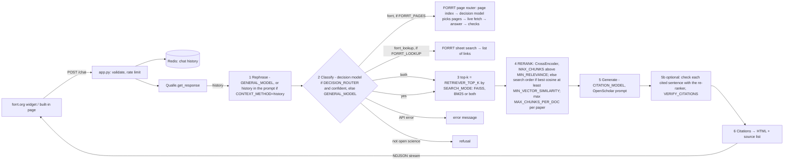

# Architecture

How the code is organised, how a question becomes an answer, and where data is cached.
Keep this file up to date when you add, move or change a code file.

## 1. Folder map

```
just-os-chatbot/
├── README.md              Setup, API, links to docs/
├── LICENSE                Project licence (GPL-3)
├── Dockerfile             3 stages: assets (Node) → app-build (uv) → app (Gunicorn)
├── compose.yaml           Services: web, redis, js, css; volumes hf-cache, redis
├── compose.dev.yaml       Dev overlay: mounts just_os/, config/, test/, eval/, scripts/, ingest/ (live reload, tests)
├── .github/workflows/     tests.yml: pytest + ruff on each PR and on pushes to main/dev/hackathon
├── compose.prod.yaml      Prod overlay: container name + external proxy network
├── run                    Task runner: ./run test, ./run lint, ./run shell, ...
├── pyproject.cpu.toml     Python deps (CPU torch); copied to pyproject.toml in the image
├── pyproject.gpu.toml     Same deps with CUDA torch (for local index builds)
├── uv.lock                Locked versions used by the Docker build
├── bin/                   Container scripts: docker-entrypoint-web, uv-install
├── config/                settings.py (all settings), gunicorn.py (server)
├── just_os/               The Flask app and the RAG pipeline
├── ingest/                Helpers to fetch metadata/PDFs and upload to Google Drive
├── scripts/               Command-line tools (index build, index download)
├── eval/                  Evaluation scripts, question sets and result CSVs
├── test/                  pytest unit tests (offline, no index needed)
├── assets/                Front-end source (JS, Tailwind CSS, images) → built into public/
├── public/                Built static files (git-ignored, made by the js/css containers)
├── docs/                  All documentation
├── vector_data/           Small vector indexes kept in Git: forrt_pages/ (FORRT page index, ~1 MB)
└── data/                  Data, PDFs, indexes (git-ignored except seed CSVs)
```

## 2. Code files

### `config/`
| File | What it does | Used by |
|---|---|---|
| `settings.py` | One dict `DEFAULT_CONFIG` with every setting (models, index path, Redis, rate limit, arena, OpenScholar server). An environment variable with the same name overrides each key (the type follows the default: bool, int, float, str). `get_config()` returns a copy | Everything |
| `refusals.csv` | The fixed refusal and error texts, one row per language (ISO 639-1 code, then `off_topic`, `no_sources`, `model_unavailable`, `generation_error`, `unexpected_error`, `about`: the self-introduction for greetings and "who are you?"); see 2.1 | `just_os/messages.py`, `eval/run.py` |
| `gunicorn.py` | Gunicorn settings from env (`WEB_CONCURRENCY`, `WEB_TIMEOUT`, `WEB_RELOAD`). `post_worker_init` loads the models and index when a worker starts, so the first request does not time out | Gunicorn (`CMD` in the Dockerfile) |

### `just_os/` (the web app)
| File | What it does | Links to |
|---|---|---|
| `app.py` | `FlaskApp`: routes, CORS allow-list, input validation, rate limits (`RateLimitManager`, Flask-Limiter on Redis; `PROXY_FIX_X_FOR` > 0 trusts `X-Forwarded-For` from that many proxies), NDJSON streaming. `get_app()` is the Gunicorn entry point | `rag_service`, `chat_manager`, `extensions`, templates |
| `rag_service.py` | Builds the pipeline once per worker (singleton): embedding model → FAISS index from `VECTOR_STORE` → retriever chosen by `SEARCH_MODE` (`hybrid.search_retriever`) → `Qualle` | `qualle`, `chat_manager`, `config.settings` |
| `eval_report.py` | Tables for `/eval` from the result CSVs (`by_model`: one row per model, its newest run, best first; the run history below): `answer_runs` (`run_label`: full pipeline, forced papers / FORRT-pages run, or a `cfg-` configuration), `classifier_runs` (false refusal/answer for both `off_topic` and the router's `neither`), `pair_results` (newest `pairs_*.csv` as a grid), `embedding_runs`, `best_defaults` (`AUTO_DEFAULTS`: the eval winners become `CITATION_MODEL` and `ROUTER` at start-up; the arena lists that model first, both pages name the default topic check) | `app` |
| `qualle.py` | The RAG pipeline. `small_talk` (a regex for greetings, thanks and questions about the bot, in a few languages: they get the `about` message, before any rephrasing or topic check; outcome `small_talk`), `page_references` (forrt.org pages as `metadata.references` entries without authors or year, so the page shows them in the Sources box), `Qualle.route` (topic check; `router` picks a strategy: decision model, LLM classifier, `cosine_route` = bge-m3 cosine to the nearest paper chunk and the nearest FORRT page description against `COSINE_PAPER_MIN`/`COSINE_PAGE_MIN`, or `none` = papers and FORRT pages without a check), `QueryProcessor` (rephrase + classify; `OPEN_SCIENCE_SCOPE` tells the topic check what counts as Open Science, in any language, or `classify_intent` into open_science / forrt_lookup / off_topic; tool call with JSON fallback), `DocumentRetriever` (top-k from the `SEARCH_MODE` retriever + local CrossEncoder re-rank, or with `RERANK=false` the search order and a `MIN_VECTOR_SIMILARITY` check on the best vector match; falls back to search order; `MAX_CHUNKS_PER_DOC` caps chunks per paper; `ADAPTIVE_TOP_K` (off by default, #33) keeps only the chunks scoring at least `ADAPTIVE_TOP_K_RATIO` of the best one, at least `ADAPTIVE_TOP_K_MIN`; `RERANK_THREADS` CPU threads; `unsupported_citations` for `VERIFY_CITATIONS`; logs `Timing:` lines), `ResponseGenerator` (prompt chosen by `PROMPT_STYLE`: `openscholar` or `short`, both with `LANGUAGE_RULE`: answer in the question's language, cite only with `[n]`, keep `GLOSSARY_TERMS` in English, and `ANSWER_STYLE`: speak to the asker ("you"), and the Markdown the page renders (lists, bold, simple tables; answers are rendered with `MARKDOWN_EXTENSIONS = ["tables"]`); `stream_response` for #41; an answer without any `[n]` is asked once more; LLM call; post-processing), `OpenAIClientManager` (OpenAI-compatible clients with a `LLM_TIMEOUT` limit; a provider error, time-out or empty answer is tried `LLM_RETRIES` (3) more times with a 1-4 s pause before the user sees an error and the chat page's **Try again** button (not OpenScholar, whose answers take minutes); an empty answer at the token cap (gpt-oss spent it on reasoning) is retried with low reasoning effort; a streamed answer that ends empty falls back to this call; OpenScholar `OPENSCHOLAR_TIMEOUT` and no retry; sends `OPENSCHOLAR_MODEL` to the self-hosted server), `ReferenceProcessor` (citation numbers → HTML + source list: one number per paper (`paper_key`: by title, so a preprint and its journal version share it; adjacent repeats such as `[1][1]` collapse), publication year, doi.org links, passage only for open licences; `snippets`: per cited paper the sentence of the cited chunk that best matches the answer sentence citing it, `best_snippet` in `references.py`, same licence rule), `Qualle` (`get_response`, `get_arena_response`) | `openscholar`, `chat_manager` |
| `messages.py` | Refusal and error texts in the language of the question: reads `config/refusals.csv`, detects the language with lingua over all its languages (Kannada by its script, which lingua lacks), falls back to English for a language without a row or one it cannot tell; `confident_language` returns a language only for a clear question (3+ words or a non-Latin script, confidence ≥ 0.10), and English when the words without capitalised names read as English ("best pizza in Maastricht" was Dutch) | `qualle`, `app`, `eval/run`; words with two or more capitals (DNA, HARKing) are ignored for detection |
| `answer_cache.py` | `AnswerCache`: semantic answer cache in Redis (`ANSWER_CACHE_TTL` > 0 turns it on) | `qualle` |
| `forrt_lookup.py` | `FORRT_LOOKUP=true`: `ForrtLookup` searches every row of the FORRT sheet (BM25 over title, abstract, clusters, tags) and answers with a list of links (titles escaped, http(s) only) | `qualle` |
| `decisions.py` | `DecisionClient` (`DECISION_ROUTER`, on by default): decision models (TypeSafe Jev, Cloudflare Clef / Clef-flash) through OpenRouter's decisions API (`DECISION_URL`, alpha): typed questions in, calibrated probabilities out. `route` classifies a question as open_science / forrt / both / neither (`DECISION_ROUTER`; `ROUTES` holds the descriptions the model judges by: `forrt` includes whether a specific study or DOI has been replicated, which FLoRA's tools look up); `decide` is also used to pick FORRT pages | `qualle`, `forrt_pages` |
| `forrt_pages.py` | `FORRT_PAGES` (on by default): `ForrtPages` answers questions about FORRT from forrt.org's own pages: search the page index (`FORRT_PAGES_DIR`, the app's embedding model) → the decision model `FORRT_SELECT_MODEL` scores each candidate yes/no (keep p ≥ `FORRT_DECISION_THRESHOLD`; if none, the plausible ones ≥ `FORRT_DECISION_FLOOR` plus the top search result; none → `no_sources`) → fetch the pages live from forrt.org (in-memory cache `FORRT_CACHE_TTL`; no stored page text; a page that cannot be read is skipped; news questions always read `FORRT_LISTING_URLS`) → answer with today's date and each page's age (each page whole up to `FORRT_MAX_CHARS_PER_PAGE`, 12,000 characters; longer pages keep the paragraphs, or ~500-character pieces of long lists such as `/contributors/`, that best match the question, rare words counting more) → `forrt_checks` (bare URLs become `<url>` autolinks, `autolink`, also used for paper answers in `post_process_response`) → Markdown citing `[n]`, with the pages as `sources` (Qualle puts them in the Sources box; the same text read twice, a moved page and its new address, is read once). A "this page has moved" stub (`refresh_target`: forrt.org/glossary/ → /glossary/english/) is followed. `links` gives the best pages without an answer (the `both` route: they are added to the Sources box after the papers). Its own HTML → Markdown (BeautifulSoup) **Next to the papers** (`FORRT_IN_PAPERS`, on by default): `extra_sources` searches the page index while the papers are searched; pages with a search score ≥ `FORRT_IN_PAPERS_MIN_SCORE` that the decision model clearly picks (strict: no fallback when unsure or failed) are fetched, cut to `FORRT_IN_PAPERS_MAX_CHARS` and join the paper chunks as extra sources (`[n]` citations, Sources box); the `both` route skips the score floor and then reads the pages instead of only linking them | `decisions`, `forrt_checks`, `messages` |
| `forrt_checks.py` | Rules for FORRT-page answers, enforced in code: links and emails not in the pages read are removed, `【1】` → `[1]`, citations to no page removed; an English answer to a non-English question (or the reverse) or "upcoming" next to a past date triggers one rewrite | `forrt_pages` |
| `hybrid.py` | `SEARCH_MODE` `bm25` or `hybrid`: `BM25` keyword index (scikit-learn sparse matrix, built from the docstore at start-up, ~7 s), `KeywordRetriever` (BM25 alone), `HybridRetriever` (vector and keyword lists merged by reciprocal rank fusion); `search_retriever` picks one, `vector_cosine` gives the best vector match's cosine | `rag_service`, `qualle` |
| `references.py` | Pure helpers (no heavy imports): `normalize_doi`, `reference_url` (`https://doi.org/<doi>`, else an http(s) link), `document_key` (one key per paper), `passage_allowed` (licence gate), `publication_year` + `load_publication_years` (`PUB_YEARS_FILE`), `best_snippet` (the quote under a source: Markdown and PDF-converter debris cleaned by `clean_markdown`; only `readable` sentences, which start a sentence and are at least 75% letters, else no quote) | `qualle`, `ingest/helpers`, `scripts/get_pub_years` |
| `openscholar.py` | The OpenScholar system prompt and answer template (keep the Apache-2.0 header) | `qualle` |
| `chat_manager.py` | `ChatManager`: chat history in the Redis list `chat:{chat_id}`, TTL `MESSAGE_TTL` (1 h) | `database` |
| `database.py` | `get_redis_client()`: one Redis connection per process | `chat_manager` |
| `extensions.py` | `flask_static_digest` instance (fingerprinted static files) | `app` |
| `templates/index.html` | Built-in chat page | `public/js/app.js`, `public/css/app.css` |
| `templates/arena.html` | Arena page: model picker, one card per answer, 1-5 ratings, leaderboard | `public/js/arena.js` |

### 2.1 Adding a language for refusals and errors
1. Open `config/refusals.csv` in a spreadsheet and add a row: the ISO 639-1 code in `language` (for example `pt`), then the five texts. Save as **CSV UTF-8**; other encodings break non-Latin scripts. The spreadsheet quotes texts that contain commas.
2. Run `uv run pytest test/test_messages.py`: it fails on a row with an unknown code, an empty text or too many fields, which an unquoted comma causes. The app itself logs such a row and skips it.
3. Open a PR. The row takes effect when the web container restarts (dev) or the image is rebuilt (production).

The code must be one lingua detects (75 languages, listed in the [lingua README](https://github.com/pemistahl/lingua-py#3-which-languages-are-supported)). A language lingua lacks needs its script added to `SCRIPTS` in `just_os/messages.py`, as for Kannada, which works only for a script no other language uses.

Limitations (measured 11 Nov with lingua 2.2.0 over all languages):
- **Hindi and Marathi** share the Devanagari script. Lingua told them apart on the eval questions, but on short questions its confidence for the right one is 0.50 to 0.78, so a short question can get the other language. Still to check on real questions.
- **A language lingua does not know gets the row of a language with the same script.** Nepali gets the Hindi or Marathi text (confidence 0.56 to 0.61), Konkani the Marathi text (0.92). A language lingua does not know in a script no row uses (Malayalam, Sinhala, Amharic, Odia, Burmese) gets English.
- **Very short questions in a Latin script often get English**, because lingua is unsure on a few words, more so with English terms in them: "Was ist OSF?" and "Wat is open science?" get English.
- A **minimum confidence** does not fix the second point: Nepali and Konkani score as high as real Hindi and Marathi, so any cut-off that sends them to English also sends real Hindi and Marathi questions to English.

### Routes (`just_os/app.py`)
| Route | Method | Purpose |
|---|---|---|
| `/` | GET | Built-in chat page with an "Answer model" dropdown (`CITATION_MODEL` first, then `ARENA_MODELS`) |
| `/chat` | POST | Main API (`message`, `chat_id`, optional `model` from the chat page's list) → NDJSON stream. The forrt.org widget uses it and sends no `model`: **do not change the existing fields**. The final message also carries `outcome` (`answered`, `off_topic`, `no_sources`, `error`, `forrt_lookup`, `forrt`, `both`, `small_talk`); FORRT-page answers carry their pages in `metadata.references` (title and URL, no authors or year) and `metadata.sources`, `turn_id` (for feedback) and a `snippet` per entry of `metadata.references`; each final message is appended to `CHAT_LOG_FILE`. With `"stream": true` (only the built-in page sends it) the answer also comes as `{"status": "partial", "delta": …}` messages while the model writes (#41): nothing before `[Response_Start]` or after `[Response_End]`, no unfinished `[…`; the `complete` message is the same as without streaming. Without the flag (the widget) nothing changes |
| (`/chat`, `/arena/chat`) | POST | Optional `router`: the topic check for this question, one of `ROUTERS` (`just_os/decisions.py`): `clef-flash`, `clef`, `jev` (decision models), `llm` (LLM classifier), `cosine`, `none`; unknown → 400; without it the setting `ROUTER` (default: `DECISION_ROUTER`). The pages' "Topic check" dropdown sends it; the chat log records it. In the arena the router only decides answer or refuse |
| (`/chat`) | POST | Optional `"debug": true` (the built-in page sends it while the setting `DEBUG_PANEL` is on, the default; the widget does not; `DEBUG_PANEL=false` hides the panel and ignores the flag): the final message also gets `debug`, the trace of the turn (`just_os/trace.py`): `steps` (rewrite, topic check, sources, answer, … with start and duration), `calls` (each LLM and decision-model call with tokens and the cost OpenRouter reports), `info` (router probabilities, similarities, every retrieved chunk with its re-ranker score and why it was not sent, the settings used) and `totals`. The page shows it as a line under each answer, a detail panel and a per-turn chart for the thread. Not logged; without the flag nothing changes |
| `/chat/feedback` | POST | `{turn_id, rating: good\|bad, comment?}` (comment ≤ 2000 characters); one feedback per answer; appended to `CHAT_FEEDBACK_FILE` with the question and answer |
| `/up` | GET | Health check (Docker) |
| `/arena` | GET | Arena page (only if `ARENA_ENABLED`); lists `ARENA_MODELS` (OpenScholar only when `OPENSCHOLAR_BASE_URL` is set) |
| `/arena/chat` | POST | `{message, models}`: each chosen model (1 to `ARENA_MAX_MODELS`) answers from the same sources; cards labelled A, B, C… in random order |
| `/arena/rate` | POST | `{battle_id, ratings: {A: {correct, references, clarity}}}`, each 1-5; one rating round per question; reveals the model names |
| `/arena/leaderboard` | GET | Per model: ratings, mean per criterion, overall mean, mean answer time |
| `/arena/ratings` | GET | All stored ratings (analysis) |
| `/eval` | GET | Evaluation page (all three pages share the Chat / Arena / Evaluation links of `templates/_nav.html`; Arena only when `ARENA_ENABLED`): a section menu, summary cards (best pair, answer model, topic check, search), the topic check x answer model grid (`eval/pairs.py`), answer models from the papers and from the FORRT pages, search x re-ranker, full-pipeline runs (`eval/run.py`), classifier runs (`eval/classify.py`), embedding comparison, arena ratings and the run history, read from `EVAL_RESULTS_DIR` by `just_os/eval_report.py`; empty tables when the folder is missing (the production image has no `eval/`) |
| `/review` | GET | Human review page (#8; only when `REVIEW_ITEMS_FILE` exists, then also in the nav): per question the category, what the bot should have done and did, its answer, and every source it read (title, DOI or forrt.org link, the exact passage; cited or not), with a decision (right call / should have refused / should have answered / unsure), five 1-5 scores (`REVIEW_CRITERIA` and the scale from `config/criteria.json`, shared with the arena: correctness, citation support, source relevance, completeness, clarity; n/a without an answer) and a note. The reviewer's name is required; drafts stay in the browser (localStorage); Export CSV downloads a copy. No LLM-judge score is shown |
| `/review/save` | POST | `{reviewer, scores: {item_id: {...}}}` → `REVIEW_DIR/review_<name>_<YYMMDD-HHMMSS>.csv` (a new file per save, never overwritten; `review_rows` validates the name, the ids and every value; cells starting with = + - @ get a quote so a spreadsheet does not run them). Rate-limited like `/chat` |
| `/topics` | GET | Topic map of the library (PR #52): the newest `eval/results/topic_map_*.html` (built by `eval/topic_map/`) under the site's header and links, served from `/topics/map`; in the nav after Review while such a file exists, else 404 |

### `ingest/`
| File | What it does |
|---|---|
| `helpers.py` | FORRT sheet URLs (`URL_FORRT`), `wrangle_data_*` (column names), `get_doi_from_url` (`normalize_doi`), Unpaywall lookups, `best_title_match` (accepts a title-search result only at ≥ 0.9 similarity), `download_and_save_pdf` (saves only files that start with `%PDF`), `execute_concurrent_tasks` (thread pool) |
| `drive.py` | Google Drive OAuth (`authenticate`) and upload (`upload_file`, `upload_folder`). Needs `credentials.json` |

### `scripts/` (run from the repository root)
| File | Command | What it does |
|---|---|---|
| `make_share_bundle.py` | `python scripts/make_share_bundle.py [--minimal] [--no-env]` | Zips `.env`, the index, the CSVs the bot and eval scripts read, and the embedding-comparison vectors into `share/just-os-team-bundle.zip` (git- and docker-ignored) with a `TEAM_SETUP.md` |
| `get_index.py` | `python scripts/get_index.py <zip-url>` | Downloads an index zip and unpacks it into `data/processed/` (standard library only) |
| `bootstrap_local_database.py` | `uv run python -m scripts.bootstrap_local_database` | Ingestion step 1: checks open access (Unpaywall) for the downloaded PDFs, copies them to `data/pdfs/by-doi/<doi_hash>.pdf`, writes `data/processed/just-os_db.csv`, uploads to Drive |
| `marker.sh` | `./scripts/marker.sh` | Step 2: PDF → Markdown with `marker` (GPU recommended) into `data/processed/markdown/` |
| `embed.py` | `uv run python -m scripts.embed` | Step 3: chunks the Markdown (`CHUNK_SIZE`), embeds with `EMBEDDING_MODEL`, writes `data/processed/vs_latest_<model>/`, uploads to Drive. `unique_metadata` keeps one metadata row per `doi_hash` |
| `reembed.py` | `uv run python -m scripts.reembed <index-dir> <model>` | Builds a second index from the **same chunks** with another embedding model (fair comparison) |
| `get_pub_years.py` | `python -m scripts.get_pub_years [index-dir]` | Asks OpenAlex for the publication year of every DOI in the index → `data/raw/pub_years.csv` (tracked; read via `PUB_YEARS_FILE`). Run again after a new index build |
| `add_to_index.py` | `python -m scripts.add_to_index <md-dir> <metadata.csv>` | Adds new Markdown documents to an existing index (skips DOIs/titles already in it) without a full rebuild |
| `fetch_web_resources.py` | `python -m scripts.fetch_web_resources [--sample 50]` | HTML route: web resources without DOI → Markdown + metadata in `data/processed/web_markdown/`; results of the first sample in [web-resources.md](web-resources.md) |
| `curate.py` | `./run curate [--csv rows.csv] [--limit N] [--in-place] [--no-index]` | Curator ingestion (#25): new sheet rows (or a CSV) → skip what the index has (its docstore) → DOI: Unpaywall PDF → GROBID; no DOI: page text → `add_to_index.py` into a copy `data/processed/vs_curated_<YYMMDD>` (or the live index with `--in-place`); `data/curation/<YYMMDD>/report.csv` gives every row an outcome. Guide: [curators.md](curators.md) |
| `build_forrt_pages.py` | `python -m scripts.build_forrt_pages [--limit N] [--force] [--from-prototype DIR]` | Page index for `FORRT_PAGES`: forrt.org menu pages, announcements, newsletters, FORRT's own sections and `FORRT_EXTRA_URLS_FILE` (project sites missing from the sitemap); not curated resources, clusters or glossary terms. An LLM (`FORRT_DESCRIBE_MODEL`) describes each page (summary, use when, example questions, key links); the description is embedded with `EMBEDDING_MODEL`. Incremental by sitemap `lastmod`. Output: `FORRT_PAGES_DIR/index.json` and `vectors.npy` (default `vector_data/forrt_pages/`, in Git, ~1 MB); page text is not stored |
| `match_cluster_pdfs.py` | `python -m scripts.match_cluster_pdfs` | Cluster PDF file names → title/DOI from the FORRT sheets → `data/interim/cluster_pdf_metadata.csv` (newest sheet copies) |
| `convert_cluster_pdfs.py` | `python -m scripts.convert_cluster_pdfs` (needs a GROBID server on port 8070 and `pip install pymupdf4llm requests`) | Every unique cluster PDF → GROBID (body text without the reference list, title, authors, DOI) → DOI checked against the first pages, metadata from OpenAlex → `data/processed/cluster_markdown/<doi_hash>.md` + `metadata.csv`, input of `add_to_index.py`. Books over 80 pages and PDFs without a GROBID body use pymupdf4llm |
| `justos_markdown_metadata.py` | `python -m scripts.justos_markdown_metadata` | Metadata for every JUST-OS Markdown file (also the papers that are not open access, marked "Not open access (Unpaywall)") → `data/interim/justos_markdown_metadata.csv`, input of `add_to_index.py` |
| `add_new_resources.py` | `uv run python -m scripts.add_new_resources` | Adds rows from the live FORRT sheets (`URL_FORRT`): DOI → Unpaywall → PDF download |

`python -m scripts.<name>` keeps the repository root on the import path, so `config` and `ingest` import correctly.

### `eval/`
| File | What it does | Output |
|---|---|---|
| `run.py` | Runs the full pipeline (in the web container) on `questions.jsonl` (multi-turn rows: the `history` turns first, in the same chat); records cluster, type, route, outcome, hit@7, citation validity, time, tokens, cost | `results/run_<date>_<model>.csv` |
| `compare.py` | Merges run CSVs into one Markdown table | stdout |
| `make_retrieval_set.py` | Makes the retrieval question set (seed + synthetic + translated questions) | `retrieval_questions.jsonl` |
| `coverage.py` | One reason per FORRT sheet resource for why it is (not) in the index | `results/coverage_<date>.{csv,md,svg}` |
| `judge.py` | LLM judge: share of cited sentences their source supports → column `judge_support` in a run CSV | same run CSV |
| `pairs.py` | Every topic check x answer model pair from two forced runs per model (`run.py --route open_science` / `--route forrt`) and one `classify.py --routers` run | `results/pairs_<date>.csv` (the `/eval` grid) |
| `judge_sheet.py` | An eval run as a Markdown sheet for checking the LLM judge by hand: every question with its category, expected and actual outcome, answer, cited sources (title, DOI/URL, passage) and judge score; `source_items` numbers sources as the answer cites them (papers from 0, FORRT pages from 1) | `docs/judge-check.md` |
| `build_review.py` | The same run as data for `/review`, without the judge's score | `human_review_items.json` |
| `make_arena_sheet.py` | 100 test questions for a team session (#12): open science, FORRT, both, should-refuse, two-part (Chat page), greetings; 3 random models per row | `arena_test_questions.csv`, `.xlsx` |
| `scorecard.py` | One command per named configuration in `configs.json` (#32; includes the six `search-*` settings, `SEARCH_MODE` x `RERANK`; `--route` for forced runs): runs it in batches (`run_batches.run_all`, resumable), judges it, prints the `compare.py` table of the latest run per configuration | `results/run_<date>_cfg-<name>.csv` |
| `classify.py` | Classify step only: several `GENERAL_MODEL`s (`--models`, `--intent` for 3 classes) or whole router strategies (`--routers clef-flash,clef,jev,llm,cosine,none`, scored on the 4 `route` labels; `--questions` takes several files) | Markdown table + `eval/results/classify_<YYMMDD-HHMM>.csv` (model, id, gold, predicted, seconds, usd; shown on `/eval`) |
| `compare_embeddings.py` | Retrieval-only comparison of embedding models E1–E6 (see [evaluation.md](evaluation.md)) | `results/embeddings_<date>.csv` |

### `test/`
| File | Covers |
|---|---|
| `test_qualle.py` | Citation mapping, classify error ≠ refusal, JSON fallback, OpenScholar routing |
| `test_messages.py` | Every row of `config/refusals.csv` is valid, language detection, refusals and errors in the question's language in chat and arena, English fallback |
| `test_references.py` | DOI normalisation, doi.org links, licence gate, publication year, one reference per paper, snippet per source |
| `test_retrieval.py` | Per-paper cap, BM25, rank fusion, hybrid retriever |
| `test_answer_cache.py` | Answer cache hit/miss/expiry/namespace/size, no LLM call on a hit, `PROMPT_STYLE` |
| `test_ingest.py` | Title match, `%PDF` check, `unique_metadata`, gunicorn reload flag |
| `test_pipeline_options.py` | Chosen chat model, per-model answer cache, history keeps the user's words, `CONTEXT_METHOD=history`, citation check, FORRT lookup |
| `test_forrt_pages.py` | Page extraction, link/citation/date checks, decision router and its fallback, FORRT page answer, language rewrite, `forrt` and `both` routes in `get_response` (pages in the Sources box), moved pages, small talk |
| `test_scripts.py` | Judge, classifier summary, cluster PDF names and title check, HTML text, adding to an index, team bundle, dict-valued metadata in eval |
| `test_rerank.py` | Re-ranker order and fallback to vector order |
| `test_app.py` | Arena: chosen models, hidden names, OpenScholar filter, ratings, leaderboard, bad input; ProxyFix on/off; chat log with outcome, feedback once per answer |
| `test_compare.py` | `eval/compare.py` summary numbers |
| `test_coverage.py` | Coverage reasons in `eval/coverage.py` |

### `assets/` (front end)
`js/app.js` (chat page; "How was this answer?" Good/Bad + optional comment under each answer → `/chat/feedback`), `js/arena.js` (arena page), `js/references.js` (shared source tooltip and source list with the quoted snippet; inserts metadata with `textContent`, links only for http(s) URLs), `css/app.css` (Tailwind). `esbuild.config.mjs` bundles `app.js` and `arena.js` into `public/js/`. The `js` and `css` compose services build them.

## 3. Request flow (`POST /chat`)



Each step yields a status line (`{"status": "in-progress", "message": ...}`). The last line has `status: complete`, the HTML answer and the sources.

**LLM routing** (`OpenAIClientManager`): all calls go to `BASE_URL` with `LLM_API_KEY` (OpenRouter by default). If `OPENSCHOLAR_BASE_URL` is set, calls for the model named `OPENSCHOLAR_MODEL` go to that server with `OPENSCHOLAR_API_KEY`. Thus `CITATION_MODEL=openscholar-8b` uses the self-hosted model, and classify/rephrase stay on OpenRouter.

## 4. Caching and state

| What | Where | Lifetime | Why |
|---|---|---|---|
| BM25 keyword index (only with `SEARCH_MODE` `bm25` or `hybrid`) | RAM of each worker, built at start-up from the docstore | Until the worker stops | Exact-term search; a few hundred MB |
| Embedding model, re-ranker, FAISS index | RAM of each Gunicorn worker (`rag_service` singleton), loaded in `post_worker_init` | Until the worker stops | Loading takes ~1 min and ~3 GB RAM per worker; keep `WEB_CONCURRENCY=1` |
| Model weights (bge-m3, bge-reranker-v2-m3) | Docker volume `hf-cache` → `/home/python/.cache/huggingface`; `LLAMA_INDEX_CACHE_DIR` points llama-index to the same folder | Until the volume is deleted | No 2–3 GB download on each container start |
| Chat history | Redis `chat:{chat_id}` (list, newest first): the question as the user typed it + the answer | `MESSAGE_TTL` = 1 h, reset on each message | Context for follow-up questions (rephrase or `CONTEXT_METHOD=history`); privacy-friendly |
| Rate-limit counters | Redis (Flask-Limiter `storage_uri`) | Per window in `RATE_LIMIT` | Shared by all workers |
| Answer cache (only with `ANSWER_CACHE_TTL` > 0) | Redis list `answer_cache:<hash of models, index, prompt, retrieval settings>`: question vector + final answer, newest first, max `ANSWER_CACHE_MAX_ITEMS` | `ANSWER_CACHE_TTL` seconds | A first question with cosine ≥ `ANSWER_CACHE_MIN_SIMILARITY` to a recent one gets the stored answer: no LLM call. Shared by all users (stores question text) |
| Arena rounds | Redis `arena:battle:{id}` (question, label → model + seconds) | 1 day, deleted when rated | Hide model names until the ratings are in |
| Arena ratings | Redis list `arena:ratings` (time, question, model, seconds, correct, references, clarity, answer (HTML), sources) | No expiry (`redis-cli DEL arena:ratings`) | Leaderboard. The old two-model votes stay in `arena:votes` (unused) |
| Arena ratings (copy) | `data/arena/ratings.jsonl` (`ARENA_RATINGS_FILE`), same rows, one JSON per line, appended on each rating | Kept; in Git | Backup and sharing: commit it to share the ratings with the team. Survives `docker compose down -v`. Not read by the app |
| Arena round log | `data/arena/rounds.jsonl` (`ARENA_ROUNDS_FILE`): time, battle_id, question, answers (label → model, seconds, answer, sources); one JSON per line, appended on every arena question, rated or not | Kept; in Git during the test phase only | Unrated rounds too; rating rows carry the same `battle_id` |
| Chat turns | Redis `chat:turn:{turn_id}` (the log row below) | 1 day, deleted when feedback is given | Lets `/chat/feedback` store the question and answer with the rating |
| Chat log | `data/chats/chats.jsonl` (`CHAT_LOG_FILE`): time, turn_id, chat_id, model, router, question, `lang` and `answer_lang` (`messages.confident_language` of the question and of the answer text, null when too short to tell; a mismatch is logged as a warning), outcome, answer (HTML), references, timings; one JSON per line, appended on every final chat message | Kept; **in Git during the test phase only** (public repo: remove before go-live) | Find refusals (`outcome` `off_topic`), errors (`error`) and weak answers. Writable mount `./data/chats` in `compose.yaml` |
| Chat feedback | `data/chats/feedback.jsonl` (`CHAT_FEEDBACK_FILE`): time, rating, comment, answer_time + the chat log fields | Kept; in Git during the test phase only | "How was this answer?" under each chat answer |
| Redis data | Docker volume `redis` | Until the volume is deleted | |
| Static files | `public/` with digest names (`flask-static-digest`) | Until the next build | Browser cache busting |
| Eval embeddings | `data/processed/emb_cache/<model>.npy` (float16, one row per chunk) | Until deleted | `compare_embeddings.py` embeds the 59,473 chunks one time per model |
| Python deps | Docker layer from `uv.lock` (`bin/uv-install`) | Until `uv.lock` changes | Fast rebuilds |

The answer cache is off by default. Follow-up questions (chats with history) never use it.

## 5. Index format

An index folder (`data/processed/vs_latest_<model>/`) is a llama-index storage folder:

| File | Content |
|---|---|
| `default__vector_store.json` | FAISS `IndexFlatL2` vectors (one per chunk) |
| `docstore.json` | Chunk text + metadata (title, creators, DOI, licence, …) + link to the parent document |
| `index_store.json` | Index structure |
| `graph_store.json`, `image__vector_store.json` | Empty (llama-index defaults) |

`EMBEDDING_MODEL` and `VECTOR_STORE` must match: the question is embedded with the same model as the chunks.

### FORRT page index (`vector_data/forrt_pages/`, `FORRT_PAGES`)

**The index holds links and short descriptions, not page content.** It tells the router *which* forrt.org pages to read; the text of those pages is always fetched live from forrt.org when a question comes in (`ForrtPages.fetch`, in-memory cache `FORRT_CACHE_TTL`). No page text is stored in the index, in `vector_data/` or anywhere on disk, so answers always use the current version of a page.

| File | Content |
|---|---|
| `index.json` | One record per page (about 160): `url` (the link that is fetched live), `title`, `section`, `lastmod` (from the sitemap), `date` (publish date, for news), `chars` (page length when described), and an LLM-written **description** used only for search and page selection: `summary` (2–3 sentences), `use_when`, `example_questions` (5), `page_kind`, `freshness`, `key_links` (up to 6 `{url, label}`), `described_by` |
| `vectors.npy` | float32 array, one row per record in the same order: the `EMBEDDING_MODEL` vector of the record's description (title + summary + use when + example questions), not of the page text |

`EMBEDDING_MODEL` must be the model the index was built with (bge-m3). Rebuild with `python -m scripts.build_forrt_pages` when pages are added or change: it reads each page live to (re)write its description, but keeps only the description.
