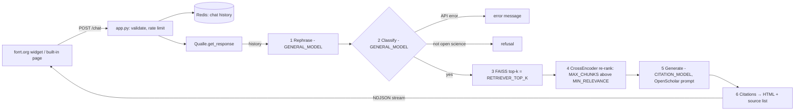

# Architecture

How the code is organised, how a question becomes an answer, and where data is cached.
Keep this file up to date when you add, move or change a code file.

## 1. Folder map

```
just-os-chatbot/
├── README.md              Setup, API, links to docs/
├── LICENSE                Project licence (GPL-3)
├── Dockerfile             3 stages: assets (Node) → app-build (uv) → app (Gunicorn)
├── compose.yaml           Services: web, redis, js, css; volumes hf-cache, redis
├── compose.dev.yaml       Dev overlay: mounts just_os/, config/, test/, eval/ (live reload)
├── compose.prod.yaml      Prod overlay: container name + external proxy network
├── run                    Task runner: ./run test, ./run lint, ./run shell, ...
├── pyproject.cpu.toml     Python deps (CPU torch); copied to pyproject.toml in the image
├── pyproject.gpu.toml     Same deps with CUDA torch (for local index builds)
├── uv.lock                Locked versions used by the Docker build
├── bin/                   Container scripts: docker-entrypoint-web, uv-install
├── config/                settings.py (all settings), gunicorn.py (server)
├── just_os/               The Flask app and the RAG pipeline
├── ingest/                Helpers to fetch metadata/PDFs and upload to Google Drive
├── scripts/               Command-line tools (index build, index download)
├── eval/                  Evaluation scripts, question sets and result CSVs
├── test/                  pytest unit tests (offline, no index needed)
├── assets/                Front-end source (JS, Tailwind CSS, images) → built into public/
├── public/                Built static files (git-ignored, made by the js/css containers)
├── docs/                  All documentation
└── data/                  Data, PDFs, indexes (git-ignored except seed CSVs)
```

## 2. Code files

### `config/`
| File | What it does | Used by |
|---|---|---|
| `settings.py` | One dict `DEFAULT_CONFIG` with every setting (models, index path, Redis, rate limit, arena, OpenScholar server). An environment variable with the same name overrides each key (the type follows the default: bool, int, float, str). `get_config()` returns a copy | Everything |
| `gunicorn.py` | Gunicorn settings from env (`WEB_CONCURRENCY`, `WEB_TIMEOUT`, `WEB_RELOAD`). `post_worker_init` loads the models and index when a worker starts, so the first request does not time out | Gunicorn (`CMD` in the Dockerfile) |

### `just_os/` (the web app)
| File | What it does | Links to |
|---|---|---|
| `app.py` | `FlaskApp`: routes, CORS allow-list, input validation, rate limits (`RateLimitManager`, Flask-Limiter on Redis), NDJSON streaming. `get_app()` is the Gunicorn entry point | `rag_service`, `chat_manager`, `extensions`, templates |
| `rag_service.py` | Builds the pipeline once per worker (singleton): embedding model → FAISS index from `VECTOR_STORE` → retriever → `Qualle` | `qualle`, `chat_manager`, `config.settings` |
| `qualle.py` | The RAG pipeline. `QueryProcessor` (rephrase + classify; tool call with JSON fallback), `DocumentRetriever` (FAISS top-k + local CrossEncoder re-rank; falls back to vector order), `ResponseGenerator` (prompt + LLM call + post-processing), `OpenAIClientManager` (OpenAI-compatible clients; sends `OPENSCHOLAR_MODEL` to the self-hosted server), `ReferenceProcessor` (citation numbers → HTML + source list), `Qualle` (`get_response`, `get_arena_response`) | `openscholar`, `chat_manager` |
| `openscholar.py` | The OpenScholar system prompt and answer template (keep the Apache-2.0 header) | `qualle` |
| `chat_manager.py` | `ChatManager`: chat history in the Redis list `chat:{chat_id}`, TTL `MESSAGE_TTL` (1 h) | `database` |
| `database.py` | `get_redis_client()`: one Redis connection per process | `chat_manager` |
| `extensions.py` | `flask_static_digest` instance (fingerprinted static files) | `app` |
| `templates/index.html` | Built-in chat page | `public/js/app.js`, `public/css/app.css` |
| `templates/arena.html` | Arena page (two anonymous answers + vote) | `public/js/arena.js` |

### Routes (`just_os/app.py`)
| Route | Method | Purpose |
|---|---|---|
| `/` | GET | Built-in chat page |
| `/chat` | POST | Main API (`message`, `chat_id`) → NDJSON stream. The forrt.org widget uses it: **do not change the fields** |
| `/up` | GET | Health check (Docker) |
| `/arena` | GET | Arena page (only if `ARENA_ENABLED`) |
| `/arena/chat` | POST | Two random models from `ARENA_MODELS` answer with the same sources |
| `/arena/vote` | POST | Vote `a`, `b`, `tie` or `bad` for a battle |
| `/arena/votes` | GET | Leaderboard data |

### `ingest/`
| File | What it does |
|---|---|
| `helpers.py` | FORRT sheet URLs (`URL_FORRT`), `wrangle_data_*` (column names), `get_doi_from_url`, Unpaywall lookups, `download_and_save_pdf`, `execute_concurrent_tasks` (thread pool) |
| `drive.py` | Google Drive OAuth (`authenticate`) and upload (`upload_file`, `upload_folder`). Needs `credentials.json` |

### `scripts/` (run from the repository root)
| File | Command | What it does |
|---|---|---|
| `get_index.py` | `python scripts/get_index.py <zip-url>` | Downloads an index zip and unpacks it into `data/processed/` (standard library only) |
| `bootstrap_local_database.py` | `uv run python -m scripts.bootstrap_local_database` | Ingestion step 1: checks open access (Unpaywall) for the downloaded PDFs, copies them to `data/pdfs/by-doi/<doi_hash>.pdf`, writes `data/processed/just-os_db.csv`, uploads to Drive |
| `marker.sh` | `./scripts/marker.sh` | Step 2: PDF → Markdown with `marker` (GPU recommended) into `data/processed/markdown/` |
| `embed.py` | `uv run python -m scripts.embed` | Step 3: chunks the Markdown (`CHUNK_SIZE`), embeds with `EMBEDDING_MODEL`, writes `data/processed/vs_latest_<model>/`, uploads to Drive |
| `reembed.py` | `uv run python -m scripts.reembed <index-dir> <model>` | Builds a second index from the **same chunks** with another embedding model (fair comparison) |
| `add_new_resources.py` | `uv run python -m scripts.add_new_resources` | Adds rows from the live FORRT sheets (`URL_FORRT`): DOI → Unpaywall → PDF download |

`python -m scripts.<name>` keeps the repository root on the import path, so `config` and `ingest` import correctly.

### `eval/`
| File | What it does | Output |
|---|---|---|
| `run.py` | Runs the full pipeline (in the web container) on `questions.jsonl`; records outcome, hit@7, citation validity, time, tokens, cost | `results/run_<date>_<model>.csv` |
| `compare.py` | Merges run CSVs into one Markdown table | stdout |
| `make_retrieval_set.py` | Makes the retrieval question set (seed + synthetic + translated questions) | `retrieval_questions.jsonl` |
| `compare_embeddings.py` | Retrieval-only comparison of embedding models E1–E6 (see [evaluation.md](evaluation.md)) | `results/embeddings_<date>.csv` |

### `test/`
| File | Covers |
|---|---|
| `test_qualle.py` | Citation mapping, classify error ≠ refusal, JSON fallback, OpenScholar routing |
| `test_rerank.py` | Re-ranker order and fallback to vector order |
| `test_app.py` | Arena routes with a fake RAG service and fakeredis |
| `test_compare.py` | `eval/compare.py` summary numbers |

### `assets/` (front end)
`js/app.js` (chat page), `js/arena.js` (arena page), `js/references.js` (shared source tooltip), `css/app.css` (Tailwind). `esbuild.config.mjs` bundles `app.js` and `arena.js` into `public/js/`. The `js` and `css` compose services build them.

## 3. Request flow (`POST /chat`)



Each step yields a status line (`{"status": "in-progress", "message": ...}`). The last line has `status: complete`, the HTML answer and the sources.

**LLM routing** (`OpenAIClientManager`): all calls go to `BASE_URL` with `LLM_API_KEY` (OpenRouter by default). If `OPENSCHOLAR_BASE_URL` is set, calls for the model named `OPENSCHOLAR_MODEL` go to that server with `OPENSCHOLAR_API_KEY`. Thus `CITATION_MODEL=openscholar-8b` uses the self-hosted model, and classify/rephrase stay on OpenRouter.

## 4. Caching and state

| What | Where | Lifetime | Why |
|---|---|---|---|
| Embedding model, re-ranker, FAISS index | RAM of each Gunicorn worker (`rag_service` singleton), loaded in `post_worker_init` | Until the worker stops | Loading takes ~1 min and ~3 GB RAM per worker; keep `WEB_CONCURRENCY=1` |
| Model weights (bge-m3, bge-reranker-base) | Docker volume `hf-cache` → `/home/python/.cache/huggingface`; `LLAMA_INDEX_CACHE_DIR` points llama-index to the same folder | Until the volume is deleted | No 2–3 GB download on each container start |
| Chat history | Redis `chat:{chat_id}` (list, newest first) | `MESSAGE_TTL` = 1 h, reset on each message | Rephrase follow-up questions; privacy-friendly |
| Rate-limit counters | Redis (Flask-Limiter `storage_uri`) | Per window in `RATE_LIMIT` | Shared by all workers |
| Arena battles | Redis `arena:battle:{id}` | 1 day, deleted on vote | Hide model names until the vote |
| Arena votes | Redis list `arena:votes` | No expiry (`redis-cli DEL arena:votes`) | Leaderboard |
| Redis data | Docker volume `redis` | Until the volume is deleted | |
| Static files | `public/` with digest names (`flask-static-digest`) | Until the next build | Browser cache busting |
| Eval embeddings | `data/processed/emb_cache/<model>.npy` (float16, one row per chunk) | Until deleted | `compare_embeddings.py` embeds the 59,473 chunks one time per model |
| Python deps | Docker layer from `uv.lock` (`bin/uv-install`) | Until `uv.lock` changes | Fast rebuilds |

There is no answer cache: the same question two times makes the same LLM calls two times (see issue "Semantic answer cache" in [issues.md](issues.md)).

## 5. Index format

An index folder (`data/processed/vs_latest_<model>/`) is a llama-index storage folder:

| File | Content |
|---|---|
| `default__vector_store.json` | FAISS `IndexFlatL2` vectors (one per chunk) |
| `docstore.json` | Chunk text + metadata (title, creators, DOI, licence, …) + link to the parent document |
| `index_store.json` | Index structure |
| `graph_store.json`, `image__vector_store.json` | Empty (llama-index defaults) |

`EMBEDDING_MODEL` and `VECTOR_STORE` must match: the question is embedded with the same model as the chunks.
